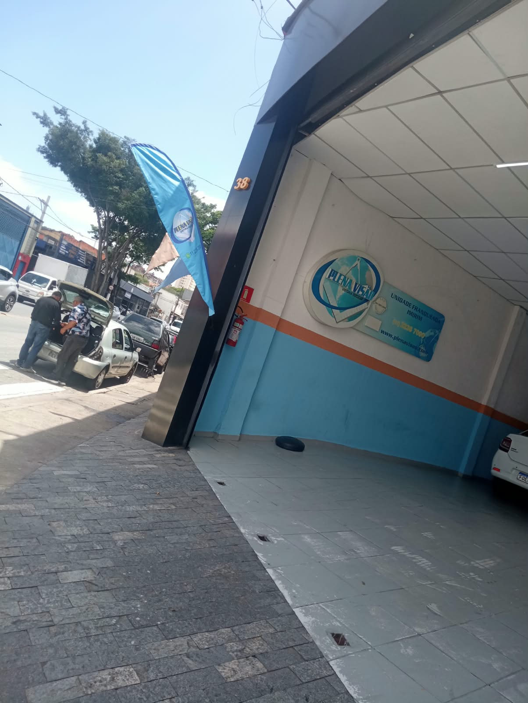
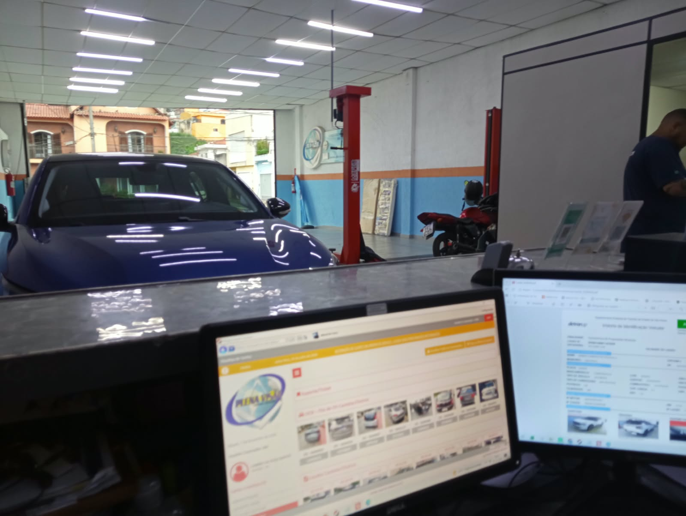
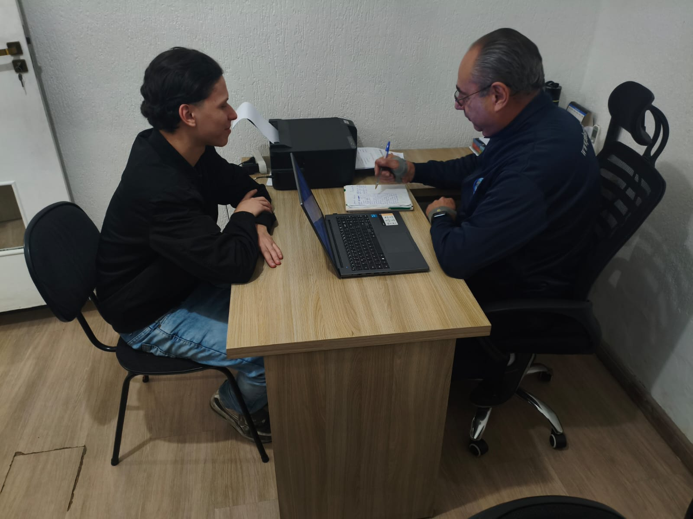
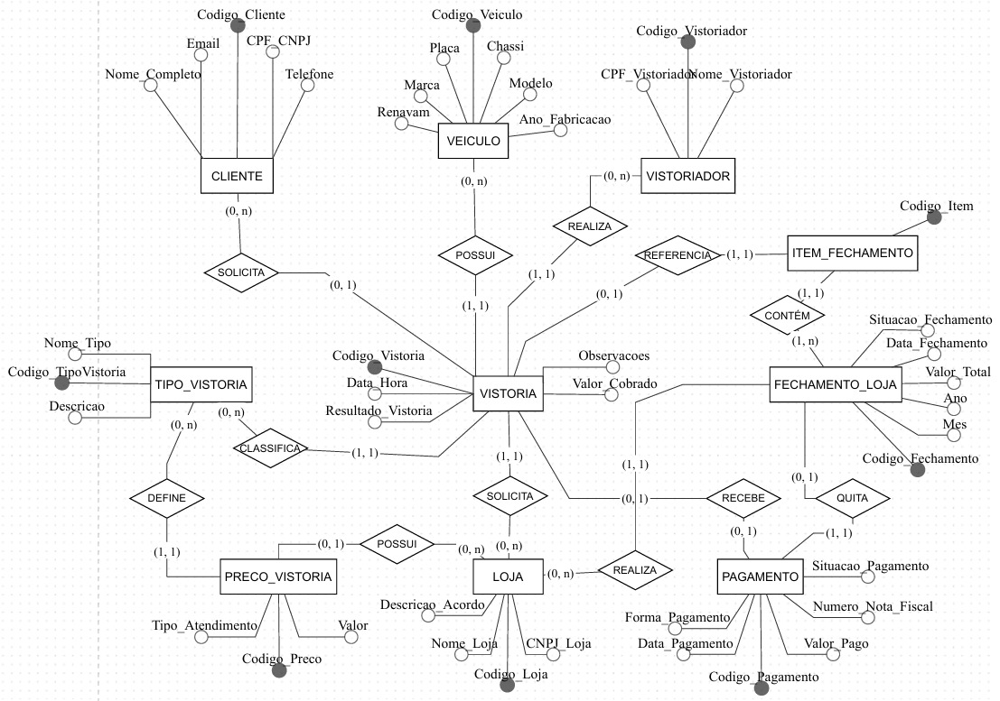
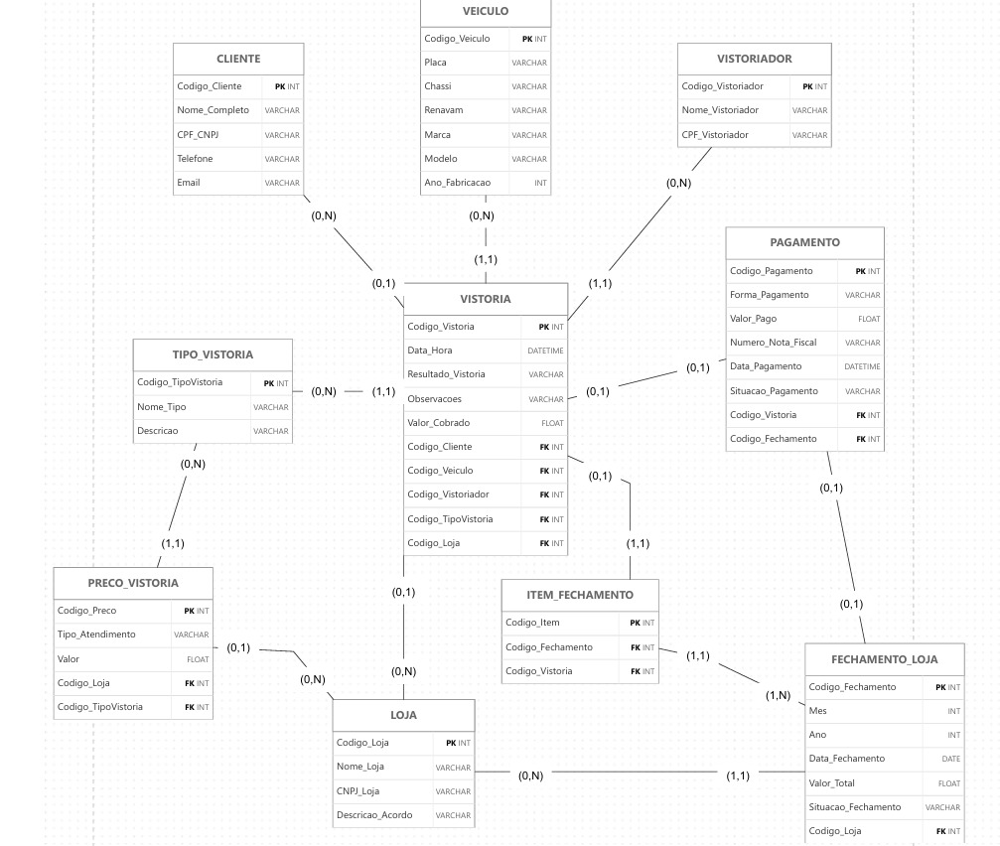

# PLENA VISÃO VISTORIA
## Projeto Acadêmico — Modelagem de Banco de Dados

## Integrantes

| Nome Completo | RGM | GitHub |
|---|---|---|
| Gabriel da Silva Santos | 47256818 | [GabrielSilvaSantos-tech](https://github.com/GabrielSilvaSantos-tech) |
| Gustavo Francisco dos Santos | 48250457 |[ Gustavofranciscodossanntos31-crypto](https://github.com/Gustavofranciscodossantos31-crypto) |
| Henrique Constantino | 47219190 | [RiqueCosta27](https://github.com/RiqueCosta27) |
| João Victor Rodrigues de Araujo | 47585650 | [joaoaraujo2023-crypto](https://github.com/joaoaraujo2023-crypto) |

---

# 1. RELATÓRIO TÉCNICO FINAL

## 1.1.1 Revisão do Modelo Conceitual

A Plena Visão Vistoria atua no segmento de inspeção e vistoria veicular, por meio de unidades franqueadas. A unidade Imirim, objeto deste projeto, oferece serviços de vistoria cautelar, vistoria de transferência (ECV) e vistoria de infração.

O projeto foi desenvolvido com foco exclusivo na unidade localizada na Avenida Direitos Humanos, nº 38, bairro Imirim, São Paulo – SP, CEP 02475-000.

A unidade possui aproximadamente 6 funcionários e atende veículos de diferentes categorias, como carros, motos, caminhões e ônibus.

A organização realiza atendimentos a clientes particulares e mantém relacionamento comercial com lojas parceiras, utilizando ferramentas específicas para os procedimentos técnicos e ferramentas administrativas para organizar seus registros.

**Responsável pela organização:** Durval Aparecido Maffia — proprietário.

**Telefone de contato:** (11) 2236-7090.

### 1.1.2 Visita técnica e entrevista

O grupo realizou uma visita técnica à unidade Imirim da Plena Visão Vistoria no dia 22 de setembro de 2026, com entrevista ao proprietário Durval Aparecido Maffia.

Durante a visita, os integrantes tiveram a oportunidade de conhecer o ambiente de trabalho e acompanhar a realização de algumas vistorias veiculares.

A entrevista permitiu compreender o funcionamento dos atendimentos, os registros utilizados pelos funcionários, o relacionamento com as lojas parceiras e o processo de fechamento mensal.

**Dados da visita:**

- Organização: Plena Visão Vistoria.
- Unidade visitada: Imirim.
- Endereço: Avenida Direitos Humanos, nº 38, Imirim, São Paulo – SP, CEP 02475-000.
- Entrevistado: Durval Aparecido Maffia.
- Função: Proprietário.
- Data: 22/09/2026.

**Respostas obtidas na entrevista:**

A empresa utiliza anotações em cadernos, folhas e conversas pelo WhatsApp para registrar e consultar informações relacionadas às vistorias.

As lojas parceiras possuem valores próprios para cada modalidade de vistoria. Os atendimentos dessas lojas são reunidos em fechamentos mensais, organizados em planilhas do Excel.

Os clientes particulares realizam o pagamento no próprio atendimento, enquanto os valores das lojas parceiras são reunidos para cobrança por boleto.

**Observações realizadas presencialmente:**

Durante a visita, o grupo acompanhou a realização de algumas vistorias e observou parte da rotina de atendimento e execução dos serviços.

As informações observadas presencialmente foram consideradas separadamente das respostas fornecidas pelo entrevistado.

#### Evidências da visita técnica

**Registro da empresa**

**Visita técnica**

### 1.1.3 Processos de negócio mapeados

Com base nas informações obtidas durante a visita e na entrevista, foram identificados os seguintes processos:

1. Atendimento de clientes particulares e lojas parceiras.
2. Identificação e registro dos veículos.
3. Realização de vistorias veiculares.
4. Identificação do vistoriador responsável.
5. Registro das informações relacionadas às vistorias.
6. Registro dos resultados e observações das vistorias cautelares.
7. Registro dos valores e das formas de pagamento.
8. Organização das vistorias realizadas para cada loja parceira.
9. Elaboração dos fechamentos mensais.
10. Consulta de informações e histórico de vistorias.
#### Processos não contemplados no escopo

Algumas atividades da empresa não foram incluídas no escopo do projeto, pois não fazem parte da finalidade do banco de dados proposto.

- **Execução técnica dos procedimentos de vistoria:** não será gerenciada pelo banco de dados desenvolvido, pois a empresa já utiliza sistemas específicos para essas atividades.
- **Emissão de laudos técnicos:** continuará sendo realizada pelos sistemas MEGA LAUDO e OXXY, sem substituição ou interferência do banco de dados proposto.
- **Gestão financeira completa da empresa:** o projeto contempla apenas o registro dos valores relacionados às vistorias e a organização dos fechamentos mensais das lojas parceiras, não abrangendo toda a administração financeira da organização.

### 1.1.4 Sistemas e ferramentas utilizados

A empresa utiliza diferentes ferramentas para executar suas atividades:

- **MEGA LAUDO:** utilizado nos procedimentos de vistoria cautelar.
- **OXXY:** utilizado nos procedimentos de vistoria de transferência (ECV) e infração.
- **Microsoft Excel:** utilizado para organizar os fechamentos mensais das lojas parceiras.
- **WhatsApp:** utilizado como ferramenta de comunicação e apoio aos registros.
- **Cadernos e folhas:** utilizados para anotações e consultas de informações.

O banco de dados proposto neste projeto tem como objetivo organizar os registros administrativos das vistorias e os fechamentos mensais.

O projeto não pretende substituir, modificar ou interferir nos sistemas MEGA LAUDO e OXXY.

### 1.1.5 Problemas identificados

Durante o levantamento, foram identificadas as seguintes dificuldades:

- **P01 — Informações descentralizadas:** os registros ficam distribuídos entre cadernos, folhas e conversas no WhatsApp.
- **P02 — Dificuldade de consulta:** localizar informações antigas de determinado veículo exige procurar manualmente registros anteriores.
- **P03 — Organização das vistorias:** é necessário reunir manualmente as vistorias realizadas para cada loja parceira.
- **P04 — Fechamento mensal:** os valores das vistorias precisam ser somados manualmente para elaborar a cobrança de cada loja.

### 1.1.6 Funcionamento dos registros de vistoria

Durante o levantamento, o grupo identificou um padrão utilizado nas anotações das vistorias.

Um exemplo de registro observado é:

- Tipo de vistoria: CAUTELAR.
- Placa: FRR6I41.
- Modelo: ETIOS.
- Loja ou identificação do cliente: SV.
- Vistoriador: LEONARDO.
- Resultado: NÃO CONFORME.
- Observações: histórico de roubo e furto; longarina dianteira esquerda amassada; reparo lateral esquerdo; número parcial do motor, número coletado no bloco: 1NRV239659.
- Forma de pagamento: BOLETO.

O registro apresenta informações sobre o veículo, o atendimento, o profissional responsável e o serviço realizado.

Nas vistorias cautelares, também são registradas informações sobre o resultado da inspeção e as observações identificadas durante o procedimento.

Nas vistorias ECV e de infração, o registro apresentado segue o mesmo padrão básico de identificação, sem os campos de resultado e observações utilizados no exemplo cautelar.

A identificação do atendimento pode corresponder ao nome da loja parceira ou à identificação do cliente particular.

### 1.1.7 Valores e formas de pagamento

Os valores praticados para clientes particulares informados durante o levantamento são:

| Tipo de vistoria | Valor |
| :--- | ---: |
| ECV — Transferência | R$ 135,00 |
| Vistoria Cautelar | R$ 299,00 |
| Vistoria de Infração | R$ 190,00 |

Para as lojas parceiras, os valores são individualizados de acordo com cada loja e o tipo de vistoria contratado.

**Formas de pagamento:**

- Clientes particulares: dinheiro, PIX, cartão de débito e cartão de crédito.
- Lojas parceiras: cobrança por boleto, organizada por meio do fechamento mensal.

O pagamento é registrado junto às informações da vistoria.

### 1.1.8 Processo de fechamento mensal das lojas

O fechamento mensal é realizado por meio da reunião das vistorias efetuadas para cada loja parceira durante determinado mês.

O responsável pelo fechamento organiza as informações em uma planilha do Excel, contendo:

- Placa do veículo.
- Modelo do veículo.
- Tipo de vistoria.
- Valor individual de cada vistoria.
- Total geral do período.

Após a organização dos registros, os valores são somados e o fechamento é enviado ao responsável pela loja parceira.

O prazo informado para pagamento é de até dois dias após o envio do fechamento.

O banco de dados proposto busca facilitar essa organização, permitindo relacionar cada vistoria à respectiva loja e reunir os valores para o fechamento mensal.

### 1.1.9 Escopo e justificativa do projeto

O projeto contempla exclusivamente a unidade Imirim da Plena Visão Vistoria.

O banco de dados tem como finalidade organizar e centralizar informações relacionadas a:

- Clientes particulares e lojas parceiras.
- Veículos cadastrados.
- Tipos de vistoria.
- Vistoriadores responsáveis.
- Registros de vistorias.
- Valores e pagamentos.
- Fechamentos mensais das lojas parceiras.

A solução foi proposta devido à necessidade de melhorar a organização dos registros, facilitar consultas ao histórico dos veículos e reduzir o trabalho manual realizado na preparação dos fechamentos mensais.

A proposta não contempla a substituição dos sistemas técnicos utilizados pela empresa, nem a emissão de laudos por meio do banco desenvolvido pelo grupo.

### 1.1.10 Requisitos funcionais

Os requisitos funcionais representam as operações que o banco de dados deverá permitir realizar.

- **RF01:** permitir o cadastro de clientes particulares e lojas parceiras.
- **RF02:** permitir o cadastro de veículos, armazenando informações como placa, chassi, Renavam, marca e modelo.
- **RF03:** permitir o cadastro dos vistoriadores responsáveis pelos atendimentos.
- **RF04:** permitir o cadastro dos tipos de vistoria: ECV, cautelar e infração.
- **RF05:** permitir o registro das vistorias realizadas, relacionando cliente ou loja, veículo, tipo de serviço e vistoriador.
- **RF06:** permitir o registro dos resultados e das observações relacionados às vistorias cautelares.
- **RF07:** permitir o registro dos valores cobrados em cada vistoria.
- **RF08:** permitir o registro das formas de pagamento utilizadas nos atendimentos.
- **RF09:** permitir a consulta do histórico de vistorias por veículo.
- **RF10:** permitir o cadastro dos preços negociados por loja parceira e tipo de vistoria.
- **RF11:** permitir o registro dos fechamentos mensais das lojas parceiras.
- **RF12:** permitir a consulta dos itens e valores que compõem cada fechamento mensal.

### 1.1.11 Requisitos não funcionais

- **RNF01 — Usabilidade:** a estrutura das informações deve ser simples e organizada, facilitando o entendimento e a consulta dos registros pelos funcionários.
- **RNF02 — Segurança:** o acesso aos dados deverá ser restrito às pessoas autorizadas pela organização, conforme os mecanismos de segurança do ambiente em que o banco será utilizado.
- **RNF03 — Integridade:** as chaves primárias, estrangeiras e restrições devem garantir a consistência dos registros.
- **RNF04 — Privacidade:** os dados utilizados na demonstração acadêmica devem ser fictícios, evitando a exposição de informações pessoais reais.
- **RNF05 — Organização:** as informações devem estar estruturadas em tabelas relacionadas, reduzindo a dispersão dos registros.
- **RNF06 — Compatibilidade:** o script deverá ser executado em ambiente MySQL compatível com os recursos utilizados no projeto.

### 1.1.12 Regras de negócio

- **RN01:** os atendimentos devem identificar se o registro pertence a um cliente particular ou a uma loja parceira.
- **RN02:** os preços das lojas parceiras devem ser individualizados conforme a loja e o tipo de vistoria.
- **RN03:** os pagamentos dos clientes particulares podem ser realizados em dinheiro, PIX, cartão de débito ou cartão de crédito.
- **RN04:** os fechamentos mensais das lojas devem apresentar placa, modelo, tipo de vistoria, valor individual e total geral.
- **RN05:** o pagamento do fechamento da loja deve ocorrer em até dois dias após seu envio.
- **RN06:** os pagamentos dos clientes particulares devem ser vinculados aos respectivos registros de vistoria.
- **RN07:** os pagamentos das lojas parceiras devem ser organizados por meio de fechamentos mensais e cobrança por boleto.
- **RN08:** cada vistoria deve estar relacionada a um veículo, um tipo de vistoria e um vistoriador responsável.
- **RN09:** as vistorias cautelares podem apresentar resultado e observações referentes às condições identificadas durante a inspeção.
- **RN10:** os valores cobrados devem corresponder ao tipo de atendimento e à condição comercial aplicável.
- **RN11:** cada vistoria deve estar vinculada a apenas um responsável pelo atendimento: cliente particular ou loja parceira.
- **RN12:** o banco de dados proposto deve organizar os registros administrativos sem substituir ou interferir nos sistemas técnicos MEGA LAUDO e OXXY.

### 1.1.13 Desenvolvimento do DER conceitual

O DER conceitual foi elaborado pelo grupo com base nas informações obtidas durante o levantamento realizado na unidade Plena Visão Vistoria — Imirim.

O modelo foi desenvolvido no brModelo e representa as entidades, os atributos, os relacionamentos e as cardinalidades necessários para organizar as informações dos processos identificados.

O modelo conceitual não apresenta chaves estrangeiras, pois elas pertencem à estrutura do modelo lógico relacional.
**Tabela de correções da Entrega 1:**

| Apontamento da correção da E1 | O que mudou no trabalho | Por quê |
| :--- | :--- | :--- |
| Ajustes de modelagem e padronização | Revisão das entidades, atributos e cardinalidades. | Melhorar a organização e a representação dos dados. |
| Uso de chaves estrangeiras no modelo conceitual | Separação das chaves estrangeiras para o modelo lógico. | As FKs pertencem ao modelo relacional. |

**Diagrama DER Conceitual**

---

## 1.2 Conversão do Modelo Conceitual para o Modelo Lógico

A conversão do modelo conceitual para o modelo lógico foi realizada por meio da transformação das entidades em tabelas, dos atributos em colunas e dos relacionamentos em chaves estrangeiras.

O modelo lógico do projeto é composto por dez tabelas:

1. `CLIENTE`
2. `VEICULO`
3. `VISTORIADOR`
4. `VISTORIA`
5. `TIPO_VISTORIA`
6. `PRECO_VISTORIA`
7. `LOJA`
8. `PAGAMENTO`
9. `FECHAMENTO_LOJA`
10. `ITEM_FECHAMENTO`

As tabelas foram estruturadas para organizar os dados dos clientes particulares, lojas parceiras, veículos, vistoriadores, tipos de vistoria, registros de serviços, preços, pagamentos e fechamentos mensais.

Cada tabela possui uma chave primária (PK) para identificar seus registros, enquanto as chaves estrangeiras (FK) estabelecem os relacionamentos entre as tabelas, garantindo a integridade referencial dos dados.

A tabela `ITEM_FECHAMENTO` permite relacionar cada fechamento mensal às vistorias que compõem a cobrança da respectiva loja.

A tabela `PRECO_VISTORIA` permite registrar os valores aplicáveis conforme o tipo de atendimento, diferenciando os preços de clientes particulares e lojas parceiras.

Dessa forma, o modelo lógico organiza as informações em estruturas relacionadas, reduzindo a duplicidade de dados e facilitando as consultas e o gerenciamento dos registros.

## 1.3 Definição das Chaves Primárias e Estrangeiras

As chaves primárias (PK) identificam exclusivamente cada registro de uma tabela. As chaves estrangeiras (FK) estabelecem os relacionamentos entre as tabelas, permitindo manter a integridade referencial do banco de dados.

A estrutura do projeto possui as seguintes chaves:

| Tabela | Chave primária | Chaves estrangeiras |
| :--- | :--- | :--- |
| CLIENTE | Codigo_Cliente | — |
| VEICULO | Codigo_Veiculo | — |
| VISTORIADOR | Codigo_Vistoriador | — |
| TIPO_VISTORIA | Codigo_TipoVistoria | — |
| LOJA | Codigo_Loja | — |
| PRECO_VISTORIA | Codigo_Preco | Codigo_Loja, Codigo_TipoVistoria |
| VISTORIA | Codigo_Vistoria | Codigo_Cliente, Codigo_Loja, Codigo_Veiculo, Codigo_Vistoriador, Codigo_TipoVistoria |
| PAGAMENTO | Codigo_Pagamento | Codigo_Vistoria, Codigo_Fechamento |
| FECHAMENTO_LOJA | Codigo_Fechamento | Codigo_Loja |
| ITEM_FECHAMENTO | Codigo_Item | Codigo_Fechamento, Codigo_Vistoria |

Além das chaves primárias e estrangeiras, o banco de dados utiliza restrições para garantir a consistência das informações.

Na tabela `VISTORIA`, cada registro deve estar vinculado a um cliente particular ou a uma loja parceira, nunca aos dois simultaneamente.

Na tabela `PAGAMENTO`, cada registro deve estar associado a uma vistoria ou a um fechamento, respeitando as regras de vinculação de cada forma de pagamento.
## 1.4 Processo de Normalização (1FN, 2FN e 3FN)

**Primeira Forma Normal (1FN):**

As tabelas foram organizadas para que cada campo armazene apenas um valor, evitando listas ou conjuntos de informações em uma mesma coluna. Cada registro possui uma identificação própria por meio de sua chave primária.

**Segunda Forma Normal (2FN):**

Os atributos não-chave dependem integralmente da chave primária de suas respectivas tabelas. Como as tabelas utilizam chaves primárias individuais, os atributos são relacionados diretamente aos registros que identificam.

**Terceira Forma Normal (3FN):**

As informações foram distribuídas em tabelas específicas, evitando a repetição desnecessária de dados e dependências transitivas. Por exemplo, os dados dos clientes, veículos, lojas e vistoriadores são armazenados separadamente e relacionados por meio de chaves estrangeiras.

**Justificativa:**

A normalização busca reduzir redundâncias, evitar inconsistências e facilitar as operações de inserção, atualização, exclusão e consulta dos registros. Essa organização contribui para a integridade e a manutenção do banco de dados.

## 1.5 Justificativas Técnicas das Decisões

**Chaves primárias:**

Foram utilizados identificadores numéricos com `AUTO_INCREMENT` para permitir a identificação única dos registros e facilitar os relacionamentos entre as tabelas.

**Chaves estrangeiras:**

As chaves estrangeiras foram utilizadas para estabelecer os relacionamentos entre clientes, veículos, vistorias, lojas, vistoriadores, pagamentos e fechamentos mensais, garantindo a integridade referencial dos dados.

**Restrições de integridade:**

Foram utilizadas restrições como `NOT NULL`, `UNIQUE`, `CHECK`, `DEFAULT` e `AUTO_INCREMENT`, conforme a necessidade de cada campo, evitando registros incompletos, duplicados ou inconsistentes.

**Relacionamentos:**

A estrutura relacional permite organizar as informações e manter a ligação entre os registros das diferentes etapas do atendimento, desde a identificação do cliente e do veículo até o registro da vistoria e do pagamento.

**Separação de responsabilidades:**

A divisão em tabelas específicas evita concentrar informações de naturezas diferentes em uma única estrutura, facilitando a organização, a manutenção e a consulta dos dados.

**Valores financeiros:**

Os valores são armazenados em campos numéricos do tipo `DECIMAL`, apropriados para representar os preços dos serviços, os pagamentos e os fechamentos mensais, evitando imprecisões comuns em tipos de ponto flutuante.

## 1.6 Proposta de Arquitetura Analítica para BI e IA

A estrutura do banco de dados permite obter informações que podem auxiliar na organização e no acompanhamento das atividades da unidade Imirim.

### Informações estratégicas

- Quantidade de vistorias realizadas por tipo.
- Valores cobrados pelos serviços.
- Distribuição das vistorias por modalidade.
- Pagamentos registrados e suas respectivas situações.
- Valores dos fechamentos mensais das lojas parceiras.
- Identificação dos clientes, veículos e lojas relacionados às vistorias.

### Indicadores propostos (KPIs)

- **KPI01 — Quantidade de vistorias por tipo:** representa a quantidade de serviços registrados em cada modalidade. 
  - Fórmula: COUNT(Codigo_Vistoria).
  - Período: todos os registros cadastrados.
  - Consulta SQL: G03.
  - Meta: não definida pela organização.

- **KPI02 — Total cobrado por tipo de vistoria:** representa a soma dos valores cobrados pelos serviços de cada modalidade.
  - Fórmula: SUM(Valor_Cobrado).
  - Período: todos os registros cadastrados.
  - Consulta SQL: G03.
  - Meta: não definida pela organização.

- **KPI03 — Valores dos fechamentos mensais:** permite acompanhar os valores registrados nos fechamentos de cada loja parceira.
  - Fórmula: utilização do campo Valor_Total da tabela FECHAMENTO_LOJA.
  - Período: mensal, conforme o mês e o ano registrados.
  - Consulta SQL: G04.
  - Meta: não definida pela organização.

### Possibilidades de BI

As consultas gerenciais podem servir como base para o desenvolvimento futuro de painéis de acompanhamento, permitindo visualizar a quantidade de serviços realizados, os valores cobrados por modalidade, os pagamentos registrados e os fechamentos financeiros das lojas parceiras.

### Possibilidades de IA

Com uma quantidade maior de dados históricos, poderão ser estudados padrões de demanda, períodos de maior movimento e tendências relacionadas aos tipos de vistoria.

Essas análises poderão auxiliar no planejamento e na tomada de decisões da organização.

Essas possibilidades representam propostas futuras, não funcionalidades já implementadas pelo grupo.

### Tabela de rastreabilidade

| Problema ou indicador | Tabelas envolvidas | Consulta SQL |
| :--- | :--- | :--- |
| P01 — Informações descentralizadas | CLIENTE, VEICULO, VISTORIA, LOJA, VISTORIADOR, TIPO_VISTORIA | G01 |
| P02 — Dificuldade para localizar registros antigos | VEICULO, VISTORIA, TIPO_VISTORIA | G01 |
| P03 — Organização das vistorias por loja | LOJA, VISTORIA | G01 |
| P04 — Cálculo manual dos fechamentos mensais | LOJA, FECHAMENTO_LOJA | G04 |
| KPI01 — Quantidade de vistorias por tipo | VISTORIA, TIPO_VISTORIA | G03 |
| KPI02 — Total cobrado por tipo | VISTORIA, TIPO_VISTORIA | G03 |
| KPI03 — Valores dos fechamentos mensais | LOJA, FECHAMENTO_LOJA | G04 |

**Observação:** as consultas G01 e G04 permitem localizar informações relacionadas aos problemas identificados. Entretanto, a contagem agrupada de vistorias por loja e a filtragem do histórico individual de cada veículo ainda podem ser aprimoradas em consultas futuras.

# 2. MODELO LÓGICO RELACIONAL

O modelo lógico relacional representa a estrutura do banco de dados por meio de tabelas, atributos, tipos de dados, chaves primárias e chaves estrangeiras.

O modelo desenvolvido contempla as dez tabelas do projeto, apresentando seus respectivos campos, tipos de dados, identificadores e relacionamentos.

O diagrama foi elaborado utilizando o brModelo e representa a estrutura relacional proposta para organizar as informações da unidade Plena Visão Vistoria — Imirim.

**Diagrama do Modelo Lógico**

---

# 3. IMPLEMENTAÇÃO DO BANCO DE DADOS — SQL

A implementação do banco de dados foi realizada utilizando o Sistema Gerenciador de Banco de Dados MySQL.

O script SQL contempla a criação do banco de dados, das dez tabelas, das chaves primárias, das chaves estrangeiras e das restrições de integridade necessárias para manter a consistência das informações.

Também foram realizadas inserções de dados fictícios para demonstrar o funcionamento do banco de dados, além de consultas SQL para recuperação de informações, consultas gerenciais e operações de auditoria.

O script contempla operações de inserção, consulta, atualização e exclusão de registros, permitindo verificar diferentes funcionalidades da estrutura desenvolvida.

**Arquivo SQL:**

[`Plena_Visao_Vistoria.sql`](./docs/Plena_Visao_Vistoria.sql)

O script deverá ser executado em um ambiente de teste, preferencialmente a partir de um banco de dados vazio, para verificar a criação das tabelas, a inserção dos registros e o funcionamento das consultas.

---

# 4. MASSA DE DADOS

A massa de dados utilizada no projeto foi desenvolvida para demonstrar o funcionamento das tabelas, dos relacionamentos e das restrições do banco de dados.

Os registros são fictícios e foram utilizados exclusivamente para fins acadêmicos, sem representar clientes ou operações reais da empresa.

A massa contempla informações relacionadas a:

- Clientes particulares.
- Lojas parceiras.
- Veículos.
- Vistoriadores.
- Tipos de vistoria.
- Preços dos serviços.
- Registros de vistorias.
- Pagamentos.
- Fechamentos mensais.
- Itens dos fechamentos.

A quantidade e a variedade dos registros foram organizadas para representar diferentes situações de atendimento da unidade Imirim, permitindo testar os relacionamentos entre as tabelas, as regras de integridade e a execução das consultas SQL desenvolvidas pelo grupo.

Os dados foram distribuídos de forma a contemplar diferentes tipos de vistoria, formas de pagamento, atendimentos particulares e de lojas parceiras, além de fechamentos mensais.

A utilização de dados fictícios permite demonstrar o funcionamento do banco de dados sem expor informações pessoais ou comerciais reais.

# 5. UTILIZAÇÃO DE INTELIGÊNCIA ARTIFICIAL

A inteligência artificial foi utilizada como ferramenta de apoio durante o desenvolvimento do projeto, principalmente na organização da documentação, revisão da modelagem e elaboração de consultas e estruturas SQL.

### Ferramenta utilizada

ChatGPT.

### Etapas em que foi utilizada

- Organização e revisão do README.
- Interpretação dos requisitos do Esqueleto 2.
- Apoio à organização dos requisitos funcionais e não funcionais.
- Revisão da estrutura das tabelas e relacionamentos.
- Apoio na elaboração e revisão do SQL.
- Organização da documentação do projeto.

### Motivação

A utilização da ferramenta teve como objetivo auxiliar o grupo na compreensão das exigências do professor e na organização das informações levantadas durante a visita técnica.

### Prompts utilizados

Foram utilizados comandos solicitando a análise do projeto, a organização das informações da empresa e a adequação do trabalho às exigências do Esqueleto 2.

Os integrantes deverão acrescentar outros prompts efetivamente utilizados durante o desenvolvimento.

### Respostas recebidas

A ferramenta apresentou sugestões de organização documental, estruturação de requisitos, relacionamentos entre tabelas e consultas SQL.

As sugestões foram analisadas e adaptadas conforme as informações levantadas pelo grupo e a estrutura real do banco de dados.

### Verificação das informações

As informações sobre a empresa foram baseadas no levantamento e na visita técnica realizada pelo grupo.

As estruturas SQL foram submetidas a testes para verificar a criação das tabelas, os relacionamentos e a execução das consultas.

### Trechos rejeitados ou corrigidos

Algumas sugestões precisaram ser adaptadas para respeitar o funcionamento real da Plena Visão Vistoria, especialmente em relação aos processos de atendimento, aos preços individualizados das lojas e aos fechamentos mensais.

### Reflexão crítica

A inteligência artificial foi utilizada como apoio, mas não substituiu a análise dos integrantes do grupo.

As informações e sugestões foram avaliadas considerando os dados obtidos na visita técnica, as necessidades da organização e os requisitos acadêmicos estabelecidos pelo professor.

---
