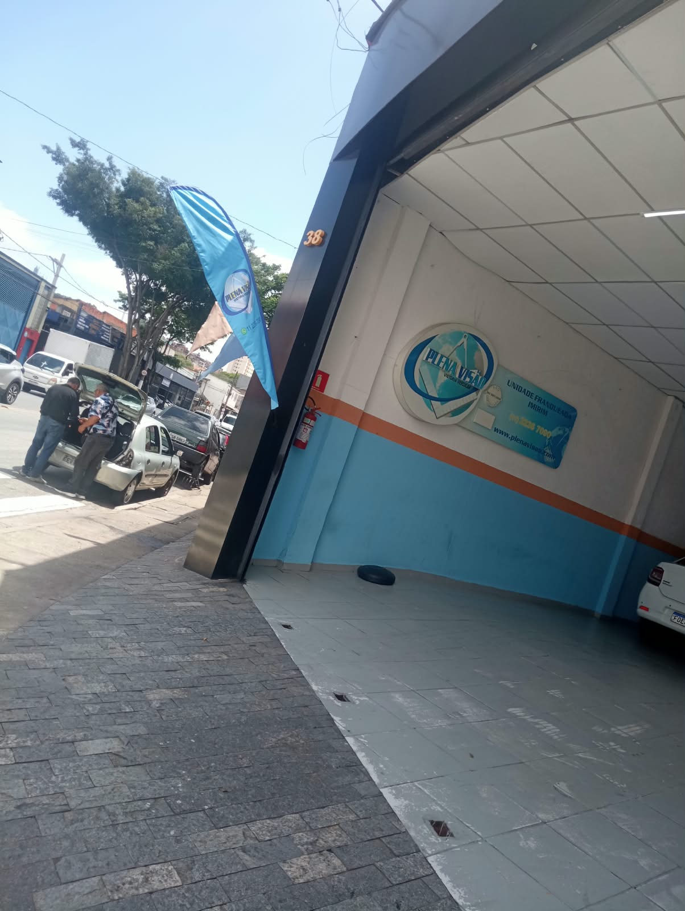
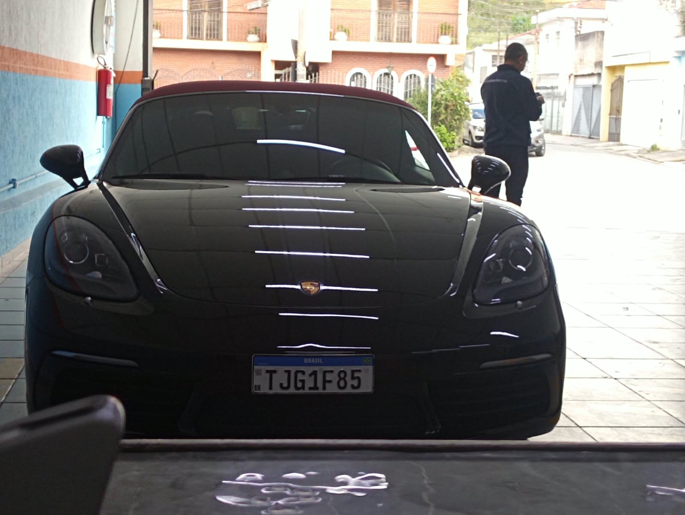
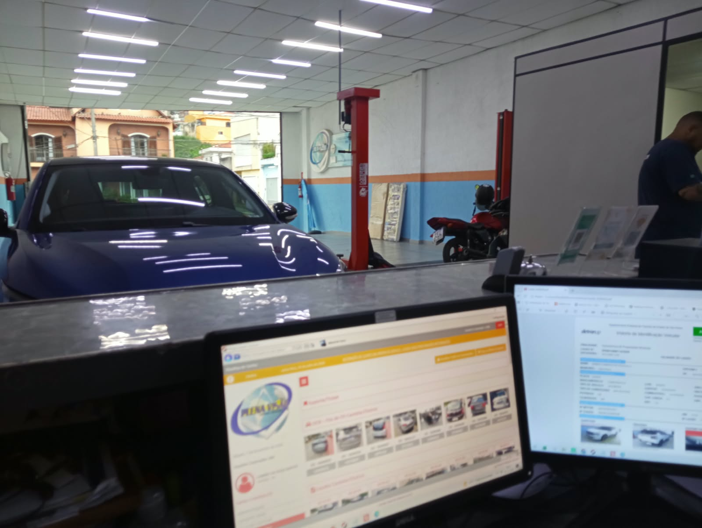
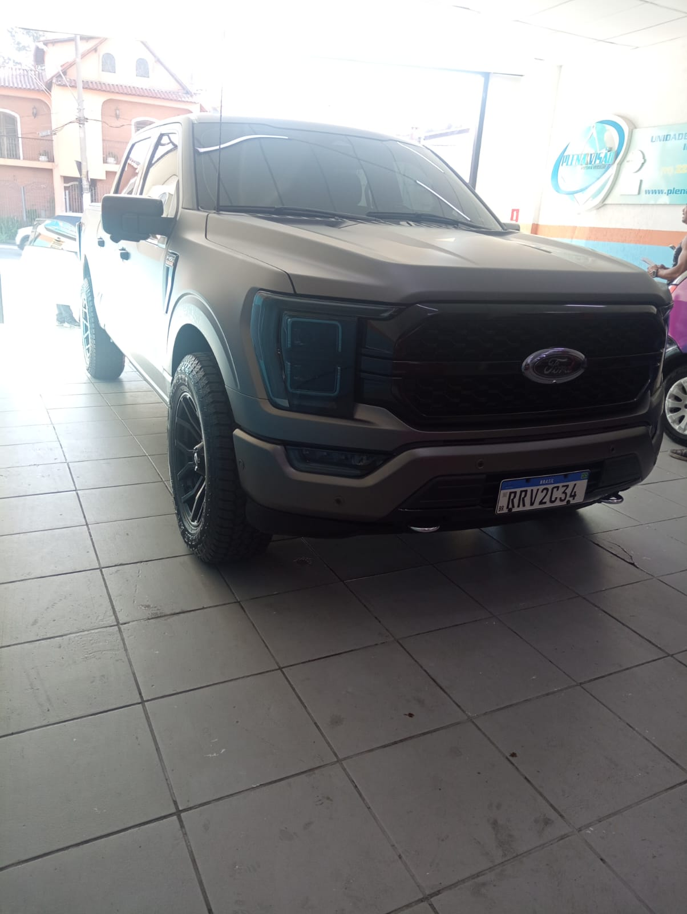
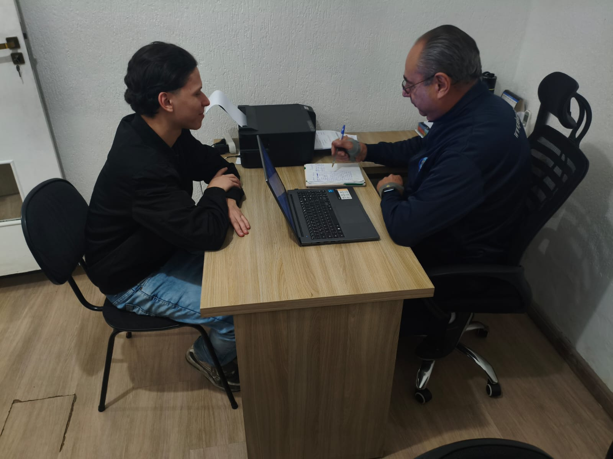

# LEVANTAMENTO DE INFORMAÇÕES

## 1. Identificação da organização

**Organização:** Plena Visão Vistoria.

**Unidade analisada:** Imirim.

**Natureza:** Unidade franqueada de uma organização privada.

**Segmento de atuação:** Inspeção e vistoria veicular.

**Endereço:** Avenida Direitos Humanos, nº 38, Imirim, São Paulo – SP, CEP 02475-000.

**Telefone:** (11) 2236-7090.

**Responsável entrevistado:** Durval Aparecido Maffia.

**Função:** Proprietário.

**Data da visita técnica:** 22/09/2026.

**Integrante que realizou a visita:** Gabriel da Silva Santos.

**Quantidade aproximada de funcionários:** 6.

## 2. Serviços oferecidos

A unidade Imirim da Plena Visão Vistoria realiza serviços de inspeção e vistoria veicular, atendendo clientes particulares e lojas parceiras.

## Volume de atividades e horário de funcionamento

A unidade realiza aproximadamente 50 a 60 vistorias por dia, atendendo veículos de diferentes categorias e clientes particulares e lojas parceiras.

**Horário de funcionamento:**

- Segunda a sexta-feira: das 08h30 às 18h00.
- Sábado: das 09h00 às 16h00.
- Domingo: não há expediente.

Os principais serviços identificados são:

- **Vistoria cautelar:** avaliação das condições e características do veículo, com registro do resultado e de observações.
- **Vistoria de transferência (ECV):** procedimento relacionado à transferência de propriedade do veículo.
- **Vistoria de infração:** serviço de vistoria relacionado a situações de infração de trânsito.

A unidade atende diferentes categorias de veículos, incluindo carros, motos, caminhões e ônibus.

## 3. Funcionamento dos atendimentos

A unidade realiza atendimentos para dois grupos principais: clientes particulares e lojas parceiras.

### 3.1 Clientes particulares

Os clientes particulares solicitam os serviços diretamente à unidade. Durante o atendimento, são registradas informações relacionadas ao cliente, ao veículo, ao tipo de vistoria e ao valor cobrado.

O pagamento é realizado no próprio atendimento, podendo ocorrer pelas seguintes formas:

- Dinheiro;
- PIX;
- Cartão de débito;
- Cartão de crédito.

### 3.2 Lojas parceiras

A unidade também atende lojas parceiras, que possuem valores comerciais próprios para cada modalidade de vistoria.

Os serviços realizados para essas lojas são registrados e posteriormente reunidos em fechamentos mensais, que organizam as vistorias e os respectivos valores para cobrança por boleto.

## 4. Sistemas e ferramentas utilizados

Durante o levantamento, foram identificadas diferentes ferramentas utilizadas na rotina da unidade:

- **MEGA LAUDO:** utilizado nos procedimentos relacionados às vistorias cautelares.
- **OXXY:** utilizado nos procedimentos de ECV e vistoria de infração.
- **Microsoft Excel:** utilizado na organização das informações e elaboração dos fechamentos mensais das lojas parceiras.
- **WhatsApp:** utilizado para comunicação e troca de informações relacionadas aos atendimentos.
- **Cadernos e folhas:** utilizados para anotações e registros de informações.

As ferramentas possuem finalidades distintas e são utilizadas conforme as necessidades dos procedimentos técnicos e administrativos da unidade.

## 5. Informações registradas

Durante o levantamento, foi identificado que os registros dos atendimentos envolvem informações sobre os clientes, veículos, serviços realizados e valores cobrados.

Entre os dados utilizados na organização dessas informações, estão:

- Identificação do cliente particular ou da loja parceira;
- Placa e modelo do veículo;
- Tipo de vistoria realizada;
- Identificação do vistoriador responsável;
- Resultado da vistoria, quando aplicável;
- Observações relacionadas à vistoria cautelar;
- Valor cobrado pelo serviço;
- Forma de pagamento, nos atendimentos particulares.

As informações são registradas por meio das ferramentas e dos controles utilizados na rotina da unidade.

## 6. Processo de fechamento mensal

Os serviços realizados para as lojas parceiras são reunidos em fechamentos mensais, organizados por loja.

O controle é elaborado em planilhas do Microsoft Excel e apresenta informações como:

- Identificação da loja parceira;
- Placa do veículo;
- Modelo do veículo;
- Tipo de vistoria realizada;
- Valor individual de cada serviço;
- Valor total do fechamento.

Após a organização das informações, o fechamento é encaminhado à loja parceira para cobrança por boleto.

O prazo informado para pagamento é de até dois dias após o envio do fechamento mensal.

## 7. Problemas identificados

Com base nas informações obtidas durante a entrevista e nas observações realizadas na visita técnica, foram identificadas as seguintes dificuldades:

- **P01 — Informações descentralizadas:** os dados relacionados aos atendimentos e às vistorias ficam distribuídos entre cadernos, folhas e conversas pelo WhatsApp.
- **P02 — Dificuldade de consulta ao histórico:** a localização de registros antigos de veículos e vistorias pode exigir a busca em diferentes meios de armazenamento.
- **P03 — Organização dos atendimentos por loja:** as informações das vistorias realizadas para lojas parceiras precisam ser reunidas manualmente para consulta e acompanhamento.
- **P04 — Fechamento mensal manual:** a consolidação dos serviços e o cálculo dos valores devidos pelas lojas parceiras são realizados por meio de planilhas do Excel.

## 8. Observações realizadas presencialmente

Durante a visita técnica realizada em 22 de setembro de 2026, foi possível conhecer o ambiente de trabalho da unidade Imirim e acompanhar parte da execução das vistorias veiculares.

Foi observado o trabalho realizado pelos profissionais durante os procedimentos de vistoria e a rotina do ambiente interno da unidade.

A visita permitiu relacionar as atividades observadas com as informações fornecidas pelo proprietário durante a entrevista.

As observações presenciais foram registradas separadamente das respostas obtidas na entrevista, respeitando a origem de cada informação.

## 9. Evidências fotográficas

### 9.1 Registro da empresa

### 9.2 Ambiente e procedimentos da visita

### 9.3 Entrevista e levantamento de informações

